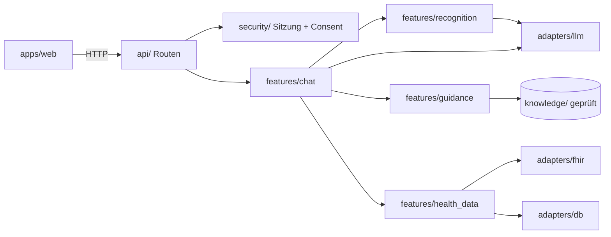

# Architektur

Ein Repository, zwei Anwendungen: `apps/web` (Website) und `apps/api` (Server). Keine Microservices. Stack: [[D01-Stack]].

## Ablauf einer Chatnachricht

1. Website sendet Nachricht an die API.
2. Route prüft Sitzung und Einwilligung (`security/`), ruft `features/chat` auf.
3. `recognition` lässt das LLM die Anfrage klassifizieren; Ausgabe wird gegen `contracts/llm/` validiert.
4. Enthält die Nachricht ein Warnzeichen-Stichwort, setzt `guidance` den festen Notfallhinweis an den Anfang.
5. Fragt der Nutzer nach eigenen Daten und ist das freigegeben: `health_data` liefert Werte, `analysis` rechnet ohne Bewertung.
6. `guidance` wählt allgemeine geprüfte Inhalte aus `knowledge/`; das LLM formuliert nur ([[D08-Zweckbestimmung]]).
7. Antwort mit KI-Kennzeichnung zurück an die Website.

## Abhängigkeitsregeln

| Von | Darf importieren |
| --- | --- |
| `api` | `features/*` (öffentlich), `security`, `core` |
| `features/<x>` | `core`, `core/ports`, `security`, andere `features/*` nur öffentlich |
| `adapters/*` | `core` |
| `security` | `core`, DB-Port |
| `core` | nichts aus dem Projekt |

Keine Zyklen. Wird mit import-linter automatisch geprüft, sobald F004 umgesetzt ist.

## Warum so

- **Fachbereiche als Ordner:** Eine Story betrifft meist einen Fachbereich. Weniger Merge-Konflikte, klare Zuständigkeit.
- **Ports in `core`:** LLM, FHIR und Datenbank sind austauschbar und in Tests durch Fakes ersetzbar.
- **Wissen getrennt vom Code:** Fachliche Reviewer prüfen `knowledge/`, ohne Code lesen zu müssen.

## Verknüpft
- [[Sicherheit-und-Grenzen]]
- [[Arbeitsablauf]]
- [[D02-FHIR]] · [[D03-Modell]] · [[D04-Fachinhalte]] · [[D05-Identitaet-Einwilligung]] · [[D06-Speicherung]]
