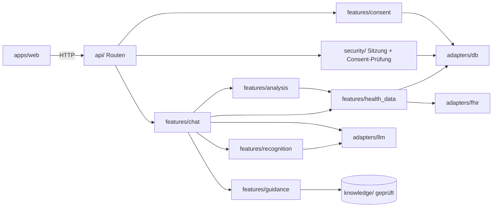

# Architektur

Ein Repository, zwei Anwendungen: `apps/web` (Website) und `apps/api` (Server). Keine Microservices. Stack: [[D01-Stack]].

## Ablauf einer Chatnachricht

1. Website sendet Nachricht an die API.
2. Route prüft Sitzung und Einwilligung (`security/`, nur lesend), ruft `features/chat` auf. Das Erteilen, Widerrufen und Löschen von Einwilligungen liegt in `features/consent` und läuft über eigene Routen, nicht über den Chat.
3. **`recognition` bestimmt die Anfrageart** – was der Nutzer will – samt Entitäten, Verneinung und Zeitbezug. Die Ausgabe wird gegen `contracts/llm/` validiert. Diese Anfrageart entscheidet über alles Weitere: welcher Pfad genommen wird und welche Information zurückkommt. Passt keine Anfrageart, folgt Rückfrage oder Abweisung (U004), kein Rateversuch.
4. Enthält die Nachricht ein Warnzeichen-Stichwort, setzt `guidance` den festen Notfallhinweis an den Anfang.
5. Fragt der Nutzer nach eigenen Daten und ist das freigegeben: `health_data` liefert Werte, `analysis` rechnet ohne Bewertung.
6. `guidance` wählt allgemeine geprüfte Inhalte aus `knowledge/`; das LLM formuliert nur ([[D08-Zweckbestimmung]]).
7. Antwort mit KI-Kennzeichnung zurück an die Website.

## Anfragearten

Der Katalog der Anfragearten ist der Dreh- und Angelpunkt des Prototyps und wird nicht beim Programmieren
erfunden:

- **Herkunft:** die Anwendungsfälle (User Stories) im Backlog. Jede Anfrageart nennt ihre Story, z. B.
  Warnzeichen-Stichwort → U001, allgemeine Gesundheitsfrage → U009, fachfremde Frage → U004.
- **Ablage:** als Enum im Ausgabeschema der Erkennung unter `contracts/llm/`, versioniert wie jeder andere
  Vertrag. Was dort nicht steht, ist keine gültige Anfrageart.
- **Grenze:** Die Anfrageart beschreibt das Anliegen, nicht die Person. Sie ist nie eine Einstufung,
  Bewertung oder Dringlichkeit ([[D08-Zweckbestimmung]]).
- **Erweiterung:** Neue oder feinere Anwendungsfälle – etwa mit Altersgruppen – kommen über das Backlog und
  erweitern das Enum. Ob und wie Personenmerkmale dabei einfließen dürfen, ist ein offener Punkt in
  [[D08-Zweckbestimmung]] und vor dem ersten solchen Anwendungsfall zu entscheiden.

## Abhängigkeitsregeln

| Von | Darf importieren |
| --- | --- |
| `api` | `features/*` (öffentlich), `security`, `core` |
| `features/<x>` | `core`, `core/ports`, `security`, andere `features/*` nur öffentlich |
| `adapters/*` | `core` |
| `security` | `core`, DB-Port |
| `core` | nichts aus dem Projekt |

Keine Zyklen. Wird mit import-linter automatisch geprüft, sobald F004 umgesetzt ist.

## Warum so

- **Fachbereiche als Ordner:** Eine Story betrifft meist einen Fachbereich. Weniger Merge-Konflikte, klare Zuständigkeit.
- **Ports in `core`:** LLM, FHIR und Datenbank sind austauschbar und in Tests durch Fakes ersetzbar.
- **Wissen getrennt vom Code:** Fachliche Reviewer prüfen `knowledge/`, ohne Code lesen zu müssen.

## Verknüpft
- [[Sicherheit-und-Grenzen]]
- [[Arbeitsablauf]]
- [[D02-FHIR]] · [[D03-Modell]] · [[D04-Fachinhalte]] · [[D05-Identitaet-Einwilligung]] · [[D06-Speicherung]]
